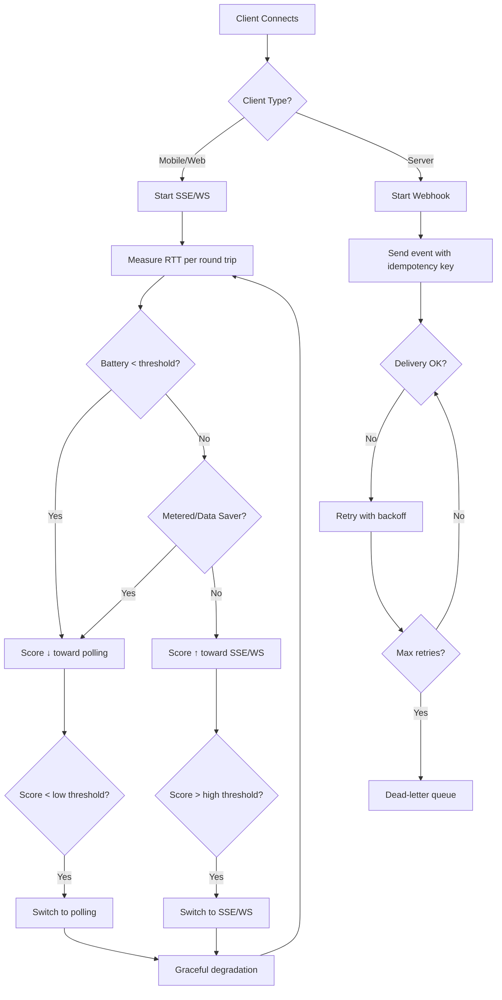

# ADR-001: Zero-Downtime Real-Time Delivery Strategy

## Context
ENVO is a real-time configuration and feature-flag management platform. Clients (mobile devices, web frontends, server processes) must receive updates without service interruption.

Current system supports five transport mechanisms:
- **SSE** (Server-Sent Events)
- **WebSocket**
- **Polling**
- **Webhook** (server-to-server)
- **Pub/Sub** (broker-based)

## Decision
Implement a **dynamic transport selection** strategy that adapts per-client based on device constraints and performance metrics, with **webhooks as the default for server clients** and **hysteresis-driven switching** to avoid flapping.

### Client Types & Preferred Transports
| Client Type | Primary Transport | Fallback |
|-------------|-------------------|----------|
| Mobile / Web Frontend | SSE or WebSocket | Polling |
| Server Process | Webhook | — |

### Transport Selection Algorithm
1. **Initial State**: Each client starts with its preferred transport (SSE for mobile/web, Webhook for servers).
2. **Round-Trip Measurement**: On each outbound request from client → server, measure RTT.
3. **Score Calculation** (simplified):
   - High RTT → lower score → consider polling
   - Low RTT + good battery/network → higher score → keep current transport
   - Battery < threshold OR metered connection → reduce score toward polling
4. **Switch Threshold**: If score drops below `threshold_low`, switch to polling; if above `threshold_high`, switch back to SSE/WS.
5. **Hysteresis**: Require at least *N* consecutive measurements before switching to prevent oscillation.
6. **Graceful Degradation**: If primary transport fails repeatedly, automatically fall back to polling while keeping the new preference in memory.

### Server-Side Webhook Guarantees (Zero Downtime)
- **Idempotency Keys**: Every webhook payload includes a unique idempotency key derived from `(event_signature, target_project, timestamp_bucket)`.
- **Retry with Exponential Backoff**: Failed deliveries are retried up to *M* attempts with exponential backoff (max delay ≤ 30 min).
- **Dead-Letter Queue**: Persist failed webhooks after max retries for manual replay.
- **Acknowledgement**: Server acknowledges receipt via short-lived token; client can confirm processing.

### Implementation Notes
- **Capacitor** provides access to battery level (`getBatteryLevel`), network mode (`isOnMeteredNetwork`), and data-saver status.
- **RTT Measurement**: Use `performance.now()` around HTTP requests; store last RTT in client state.
- **Transport Switching**: A lightweight background task monitors RTT scores every *T* seconds (e.g., 15 s) and triggers a transport update via the client SDK.
- **Schema Versioning**: All transport metadata (transport type, version) is stored alongside the event payload in the `events` table for auditability.

## Consequences
- **Positive**: Seamless experience across diverse client environments; server clients get reliable webhooks; mobile/web clients get low-latency streaming where possible.
- **Negative**: Increased complexity in client SDK; potential temporary inconsistency during transition windows (mitigated by graceful degradation).

## Transport Selection Flow

## Related Files
- `apps/api/server/tasks/event/record.ts` – Event persistence (source of truth)
- `apps/api/server/tasks/webhook/publish.ts` – Webhook dispatch (target for idempotency)
- `apps/api/server/utils/db-schema.ts` – Database schema defining `events`, `features`, `variables`
- `packages/console/src/models.ts` – Application models (not yet visible but referenced)

## Next Steps
1. Implement client-side transport evaluator (battery, network, RTT).
2. Add hysteresis constants (switch thresholds, sample window).
3. Enhance webhook task with idempotency keys and retry logic.
4. Create ADRs for each sub-component (transport protocol, idempotency, monitoring).
